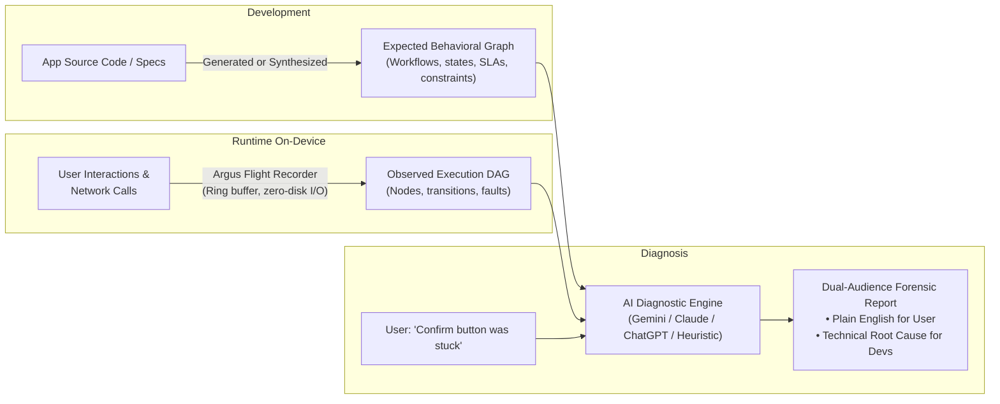
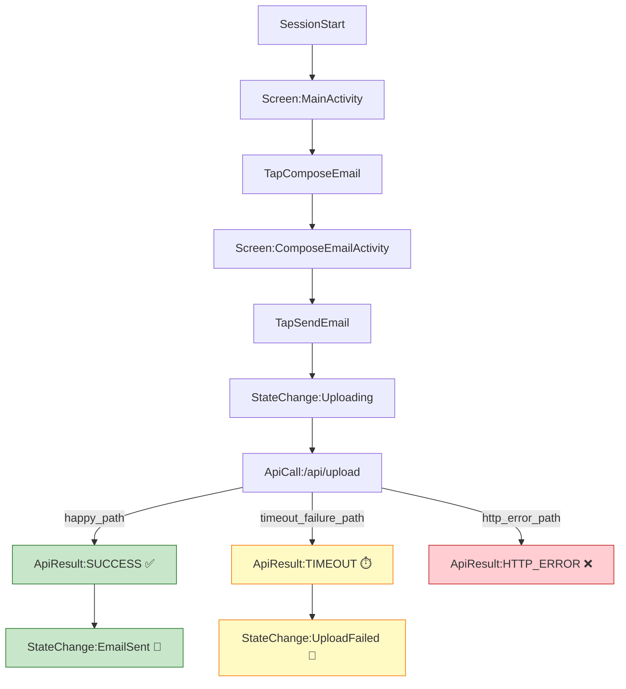

# Argus: SystemSleuth

> **AI-Powered Behavioral Self-Diagnosis for Modern Software**  
> Turning passive applications and websites into intelligent systems that understand their expected behavior, observe runtime execution graphs, and diagnose their own failures using multi-provider AI agents.

[](LICENSE)
[](#-open-source-roadmap)
[](packages/android-sdk)
[](tools/argus-companion)
[](packages/web-sdk)
[](tools/browser-extension)
[](#-universal-multi-provider-ai-support)

---

## 📖 The Problem

When users encounter technical issues in an app or website — a screen that gets stuck, an order that spins forever, an unexpected silent UI freeze, or a failed file upload — resolving it is slow, frustrating, and expensive:

1. **Vague bug reports:** Users cannot describe internal app states or technical exceptions ("*It just didn't work*").
2. **Missing context:** Developers lack a complete, chronological picture of what happened on the user's specific device, network environment, and application version.
3. **Hard-to-reproduce bugs:** Environmental factors, state machine divergences, and intermittent network timeouts are notoriously difficult to reproduce in QA.

**What if software understood how it was supposed to behave, tracked what actually happened, and diagnosed its own failures?**

---

## 💡 The Solution: Graph-Based Behavioral Self-Diagnosis

Argus replaces fragile, unsearchable text logs with **structured behavioral graphs** and **multi-provider AI reasoning**:



### The 6-Step Workflow

1. **Expected Behavioral Model:** Workflows, transitions, API dependencies, and SLA constraints are modeled as a formal Directed Acyclic Graph (DAG).
2. **Version Synchronization:** The graph updates alongside application releases or dynamic feature flags.
3. **In-Memory Flight Recording:** A lightweight on-device flight recorder maintains a rolling circular ring buffer of user gestures, navigation, and network telemetry without writing to disk during happy path.
4. **Natural Language Issue Reporting:** The user simply explains what went wrong in plain conversational language (e.g., via shake-to-diagnose, floating pill, or extension).
5. **Graph Divergence Analysis:** An AI agent cross-references the user's complaint and runtime flight telemetry against expected contracts to pinpoint the exact node, endpoint, or race condition where divergence occurred.
6. **Dual-Audience Resolution:** The agent presents an instant plain-English explanation to the user, generates a root-cause remediation report for engineers, and triggers self-healing or sharesheet export.

---

## 🤖 Universal Multi-Provider AI Support

Argus is provider-agnostic, featuring a uniform dual-audience prompt engine across all major AI agent providers with instant offline fallback:

```
                                  ┌─── Google Gemini (Flash 2.5 / 2.0 / 1.5)
                                  │
[User Complaint + Session DAG] ──┼─── Anthropic Claude (3.7 Sonnet / 3.5 Sonnet / 3.5 Haiku)
                                  │
                                  ├─── OpenAI ChatGPT / Codex (GPT-4o / GPT-4o-mini)
                                  │
                                  └─── Built-in Heuristic Engine (100% Offline & Instant)
```

| Provider | Supported Models | Key Features |
|---|---|---|
| **Google Gemini** | `gemini-2.5-flash`, `gemini-2.0-flash`, `gemini-1.5-flash` | Ultra-fast multimodal reasoning, dynamic model discovery, native JSON output. |
| **Anthropic Claude** | `claude-3-7-sonnet`, `claude-3-5-sonnet`, `claude-3-5-haiku` | Exceptional forensic root-cause analysis, direct browser CORS support via direct-access headers. |
| **OpenAI ChatGPT** | `gpt-4o`, `gpt-4o-mini`, `gpt-4-turbo` | Guaranteed JSON schema enforcement (`response_format: { type: "json_object" }`), deep SRE reasoning. |
| **Heuristic Engine** | Built-in deterministic correlator | **100% Offline & Instant:** Automatic fallback if no API key is provided or during connectivity loss. |

---

## 🏗 Three Operational Paradigms

Argus adapts to your integration constraints across mobile and web:

| Paradigm | Target | Key Tool / Package | Integration Effort | Use Case |
|---|---|---|---|---|
| **1. In-App Standalone SDKs** | First-party Android Apps & Web Apps | [`packages/android-sdk`](packages/android-sdk)<br>[`packages/web-sdk`](packages/web-sdk) | **Low** (1 line of init code, zero permissions) | You own the app source code and want zero-permission in-app self-diagnosis, shake-to-diagnose, or floating diagnostic pill. |
| **2. Non-Invasive Companion App** | Any 3rd-party Android App | [`tools/argus-companion`](tools/argus-companion) | **Zero Code Changes** (Install standalone APK) | Diagnose third-party, closed-source, or production apps using Android Accessibility & local VPN telemetry overlay. |
| **3. Browser Extension & Black-Box Scanners** | Any Web Application or Compiled APK | [`tools/browser-extension`](tools/browser-extension)<br>[`tools/apk-analyzer`](tools/apk-analyzer)<br>[`tools/web-crawler`](tools/web-crawler) | **Zero-CLI** (Chrome/Edge Extension or CLI) | Inspect live web sessions, synthesize expected graphs from DOM evidence, or analyze pre-compiled APK binaries. |

---

## 📸 Demo & Visualization

### On-Device Recording & In-App Diagnostics
In our sample workflow, the user attempts to send an email with a 4.2 MB PDF attachment. The simulated backend delays response headers, causing an OkHttp `SocketTimeoutException` at 10 seconds. Argus automatically catches the failure, flushes the execution graph, and presents an interactive in-app diagnosis dialog:

| Execution Graph Inspection | Video Walkthrough |
| :---: | :---: |
|  | [▶️ Watch Demo Video](assets/demo-video.mp4) |

*You can inspect the screen recording of the workflow in [`assets/demo-video.mp4`](assets/demo-video.mp4).*

---

### Interactive 2D & 3D Graph Visualizers

Argus includes standalone browser visualizers to explore expected and recorded behavioral graphs:

- **3D Graph Visualizer:** [`visualizer/graph-3d.html`](visualizer/graph-3d.html) — Interactive 3D orbital visualization fanning out the Happy Path, Timeout Failure Path, and HTTP Error Path in spatial coordinates.
- **2D Graph Explorer:** [`visualizer/graph-2d.html`](visualizer/graph-2d.html) — Pan-and-zoom node graph with path filtering and metadata inspection.



---

## 🗂 Repository Structure

```
Argus/
├── packages/                         # Production-Ready Diagnostic SDKs
│   ├── android-sdk/                  # In-App Android Kotlin SDK (Approach D: Zero Permissions)
│   │   ├── build.gradle.kts          # Standalone AAR Library build script
│   │   └── src/main/java/com/appsleuth/argus/sdk/
│   │       ├── Argus.kt              # Core SDK entry point (init, diagnose, showDiagnosticDialog)
│   │       ├── ArgusConfig.kt        # Multi-provider builder (.useClaude, .useOpenAi, .useGemini)
│   │       ├── crash/                # Uncaught exception interception & emergency session dumps
│   │       ├── diagnosis/            # Multi-provider AI diagnostic engine (Gemini, Claude, OpenAI)
│   │       ├── graph/                # Cumulative Session Journey DAG builder & fault detection
│   │       ├── lifecycle/            # Auto Activity/Fragment tracking & Shake-to-Diagnose
│   │       ├── network/              # Transparent OkHttp interceptor & latency recorder
│   │       ├── recorder/             # Thread-safe circular ring buffer (150 events)
│   │       └── ui/                   # In-app diagnosis dialog & native Android sharesheet exporter
│   │
│   └── web-sdk/                      # @argus/web JavaScript / TypeScript Diagnostic SDK
│       ├── argus-web.js              # Standalone browser bundle (zero build step needed)
│       └── src/                      # Interceptors (Fetch, Nav, Click, Error) & Floating Widget
│
├── tools/                            # Standalone Diagnostic & Extraction Tools
│   ├── argus-companion/              # System-Wide Android Companion App (Approach C: Zero Code Changes)
│   │   └── app/                      # AccessibilityService UI tap capture & loopback VpnService network recorder
│   ├── browser-extension/            # Chrome/Edge Extension for Multi-Provider AI Diagnosis & Graph Synthesis
│   ├── apk-analyzer/                 # Black-Box Mobile APK & on-device package deconstructor
│   ├── web-crawler/                  # Black-Box Live Web URL Crawler for automated graph synthesis
│   └── diagnostic-engine/            # Multi-Provider AI Divergence Analysis CLI / Server
│
├── examples/                         # Reference Demonstration Applications
│   ├── android-email-demo/           # Android app demonstrating In-App SDK, OkHttp timeout, & dialog
│   └── web-checkout-demo/            # Interactive Web E-Commerce Checkout with in-browser diagnostic pill
│
├── skills/                           # Test-Driven AI Graph Extractors
│   ├── android-graph-extractor/      # Test-driven extractor for Android test suites (Espresso/JUnit)
│   └── web-graph-extractor/          # Test-driven extractor for Web test suites (Playwright/Cypress)
│
├── spec/                             # Formal Graph Schemas & Reference Files
│   ├── expected_graph.json           # Formal expected behavioral contract specification
│   └── sample_execution_graph.json   # Observed on-device execution trace with timeout fault
│
├── visualizer/                       # Standalone Browser Visualizers
│   ├── graph-2d.html                 # 2D interactive canvas graph explorer
│   └── graph-3d.html                 # 3D spatial orbital visualizer
│
├── assets/                           # Screenshots and demo media
├── LICENSE                           # Apache 2.0 Open Source License
└── README.md                         # Comprehensive System Documentation
```

---

## ⚡ Quick Start & Integration

### 1. In-App Android SDK (`packages/android-sdk`)

Add the Argus SDK dependency to your Android app's `build.gradle.kts`:

```kotlin
dependencies {
    implementation("com.appsleuth.argus:argus-android-sdk:1.0.0")
    // Or project dependency in multi-module builds:
    // implementation(project(":packages:android-sdk"))
}
```

Initialize Argus in your `Application` or launch `Activity`:

```kotlin
class MyApplication : Application() {
    override fun onCreate() {
        super.onCreate()
        
        Argus.init(this, ArgusConfig.builder(this)
            // Select your AI provider of choice:
            .useClaude(apiKey = "sk-ant-...")
            // .useOpenAi(apiKey = "sk-proj-...")
            // .useGemini(apiKey = "AIzaSy...")
            .enableShakeToDiagnose(true)   // Shake phone to open diagnostic UI
            .enableCrashHandler(true)      // Auto-save flight trace on crashes
            .maxTraceEvents(150)           // Keep last 150 events in circular memory
            .build()
        )
    }
}
```

Attach the transparent network interceptor to your `OkHttpClient`:

```kotlin
val okHttpClient = OkHttpClient.Builder()
    .addInterceptor(ArgusOkHttpInterceptor())
    .build()
```

Trigger manual self-diagnosis anywhere in your UI:

```kotlin
// Shows in-app self-diagnosis dialog with plain-English explanation & developer report
Argus.showDiagnosticDialog(activity, userComplaint = "I clicked Confirm but my order never placed")
```

---

### 2. Android Companion App (`tools/argus-companion`)

Diagnose *any* Android application (e.g., food delivery, banking, e-commerce) without modifying its source code:

1. Open `tools/argus-companion` in Android Studio or install `app-debug.apk`.
2. Grant **Accessibility Service** permission (captures screen transitions, tabs, and button clicks non-invasively).
3. (Optional) Enable **Local VPN Capture** for non-root network telemetry recording.
4. Select your AI Provider (**Gemini**, **Claude**, or **ChatGPT**) in Companion Settings.
5. Launch your target app — Argus records in the background. Tap the floating diagnostic overlay to self-diagnose incidents on the fly!

---

### 3. Web Diagnostic SDK (`packages/web-sdk`)

Include the zero-build script in any web application:

```html
<script src="https://cdn.jsdelivr.net/npm/@argus/web/argus-web.js"></script>
<script>
  ArgusWeb.init({
    appName: "MyWebApp",
    autoInjectPill: true, // Floating diagnostic indicator in corner
    apiKey: "AIzaSy...",  // Optional: Gemini, Claude, or OpenAI key
    provider: "gemini"    // "gemini" | "claude" | "openai"
  });
</script>
```

---

### 4. Zero-CLI Browser Extension (`tools/browser-extension`)

1. Open `chrome://extensions` in Chrome, Brave, or Edge.
2. Enable **Developer mode** and click **Load unpacked**.
3. Select `tools/browser-extension`.
4. Browse any website — click the Argus extension icon to inspect live flight traces, visualize behavioral graphs on canvas, and run 1-click forensic self-diagnosis.

---

## 🧩 Graph Specification & Divergence Detection

### Core Node Types
- `SESSION_START`: Application initialization, device metadata, and OS environment.
- `SCREEN_VIEW` / `PAGE_VIEW`: Navigation to an Activity, Fragment, or web route.
- `USER_ACTION`: User gestures (button clicks, form submissions, back presses).
- `API_CALL`: Outbound network request with method, endpoint, and payload schema.
- `API_RESULT`: Network response, HTTP status, elapsed latency, or timeout.
- `STATE_CHANGE`: Internal state transition (e.g., `Processing`, `Confirmed`, `Failed`).
- `ERROR`: Uncaught exceptions, network failures, or handled runtime faults.

### Real-World Divergence Example
When the user states:
> *"I clicked Pay Now, but it kept loading and never placed my order."*

The diagnostic engine cross-references the session DAG:
- **Expected Happy Path:** `StateChange:ProcessingPayment` ➔ `ApiCall:/api/v1/charge` ➔ `ApiResult:200` ➔ `StateChange:OrderConfirmed`
- **Observed Trace:** `StateChange:ProcessingPayment` ➔ `ApiCall:/api/v1/charge` ➔ `ApiResult:TIMEOUT` (elapsed: `8,014ms` vs `5,000ms SLA`) ➔ `StateChange:PaymentFailed`
- **Dual-Audience Forensic Output:**
  - **👤 User Explanation:** "Your payment request took longer than expected to receive confirmation from the bank server. No funds were debited, and the transaction was safely cancelled."
  - **🛠️ Technical Root Cause:** "OkHttp SocketTimeoutException: `POST /api/v1/charge` timed out after 8,014ms (exceeding 5,000ms client SLA). Upstream payment gateway latency interrupted state machine transition."
  - **💡 Next Steps:** Check payment gateway gateway health, enable idempotent retry, check client timeout configurations.

---

## 🗺 Open-Source Roadmap

- [x] **Phase 1:** Core graph data model & schema specification (`spec/`).
- [x] **Phase 1:** Android Diagnostic SDK (Activity/Fragment lifecycle, OkHttp interceptor, in-memory flight recorder).
- [x] **Phase 1:** On-device zero-ADB export (MediaStore Downloads & native Android share sheet).
- [x] **Phase 1:** 2D canvas and 3D WebGL interactive graph visualizers (`visualizer/`).
- [x] **Phase 2:** Web Diagnostic SDK (`@argus/web`) & in-browser floating diagnostic widget (`packages/web-sdk`).
- [x] **Phase 2:** Web E-Commerce Checkout interactive demo with network scenario simulator (`examples/web-checkout-demo`).
- [x] **Phase 2:** Test-driven automated behavioral graph extraction for Android & Web (`skills/`).
- [x] **Phase 2:** Black-Box Behavioral Reconstruction for Web (`tools/web-crawler/`).
- [x] **Phase 2.2:** Browser Extension for Zero-CLI In-Browser Graph Generation & Visualizer (`tools/browser-extension/`).
- [x] **Phase 2.5:** Black-Box Mobile Behavioral Reconstruction (`tools/apk-analyzer/`).
- [x] **Phase 3:** Approach D Standalone Android SDK Library (`packages/android-sdk`) with shake-to-diagnose & in-app dialog.
- [x] **Phase 3:** Approach C Non-Invasive Android Companion App (`tools/argus-companion`) with Accessibility & VPN flight telemetry.
- [x] **Phase 3.5:** Multi-Provider AI Architecture (Google Gemini, Anthropic Claude, OpenAI ChatGPT/Codex) across Android SDK, Companion App, Browser Extension, and CLI.
- [ ] **Phase 4:** On-device local SLM inference (Gemini Nano / on-device quantized models for 100% private offline diagnosis).
- [ ] **Phase 5:** Automated self-healing actions (safe state resets, cache busting, auth token refresh, and auto-retry).

---

## 🤝 Contributing

Argus is designed to become a universal, cross-platform diagnostic layer for modern software. We welcome contributions for:
- Platform SDKs (iOS / Swift, React Native, Flutter)
- Graph extraction tooling and linters
- Diagnostic LLM prompts and fine-tuned benchmark datasets

Please feel free to open issues or submit pull requests!

---

## 📄 License

This project is licensed under the [Apache License 2.0](LICENSE).
